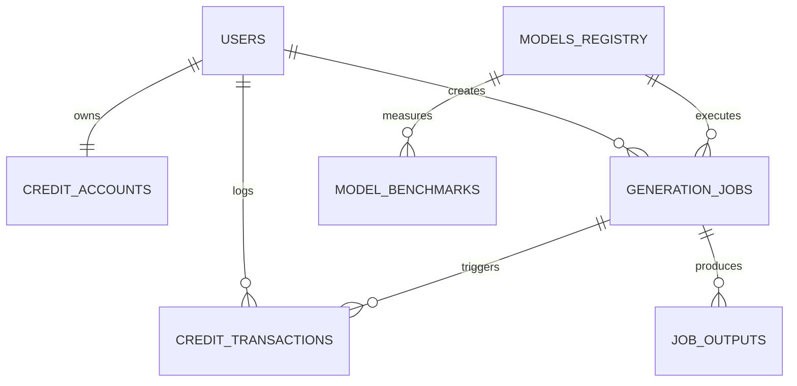

# DATABASE SCHEMA DESIGN

> **Document**: Relational Schema (PostgreSQL 16+)  
> **Status**: Approved Foundation  
> **ORM / Migration**: SQLAlchemy 2.0 (Async) + Alembic

---

## 1. Entity-Relationship Overview

---

## 2. Core Tables Specification

### 1. `users`
| Column | Type | Constraints | Description |
| :--- | :--- | :--- | :--- |
| `id` | UUID | PRIMARY KEY, default `gen_random_uuid()` | Unique user identifier |
| `email` | VARCHAR(255) | UNIQUE, NOT NULL | Account email address |
| `hashed_password` | VARCHAR(255) | NOT NULL | Salted bcrypt/argon2 hash |
| `full_name` | VARCHAR(120) | NULL | User display name |
| `role` | VARCHAR(20) | NOT NULL, DEFAULT `'user'` | Role: `'user'`, `'creator'`, `'admin'` |
| `is_active` | BOOLEAN | NOT NULL, DEFAULT `true` | Account active state |
| `created_at` | TIMESTAMPTZ | NOT NULL, DEFAULT `NOW()` | Timestamp created |
| `updated_at` | TIMESTAMPTZ | NOT NULL, DEFAULT `NOW()` | Timestamp updated |

---

### 2. `credit_accounts`
| Column | Type | Constraints | Description |
| :--- | :--- | :--- | :--- |
| `id` | UUID | PRIMARY KEY, default `gen_random_uuid()` | Account ID |
| `user_id` | UUID | UNIQUE, REFERENCES `users(id)` ON DELETE CASCADE | Associated user |
| `balance` | NUMERIC(12, 2) | NOT NULL, DEFAULT `0.00`, CHECK (`balance >= 0`) | Available spendable credits |
| `reserved` | NUMERIC(12, 2) | NOT NULL, DEFAULT `0.00`, CHECK (`reserved >= 0`) | Credits locked in in-flight jobs |
| `lifetime_spent` | NUMERIC(12, 2) | NOT NULL, DEFAULT `0.00` | Cumulative credits spent |
| `version` | INTEGER | NOT NULL, DEFAULT `1` | Optimistic concurrency control lock |
| `updated_at` | TIMESTAMPTZ | NOT NULL, DEFAULT `NOW()` | Timestamp updated |

---

### 3. `credit_transactions` (Immutable Ledger)
| Column | Type | Constraints | Description |
| :--- | :--- | :--- | :--- |
| `id` | UUID | PRIMARY KEY, default `gen_random_uuid()` | Transaction ID |
| `user_id` | UUID | REFERENCES `users(id)`, NOT NULL | Account debited/credited |
| `job_id` | UUID | REFERENCES `generation_jobs(id)`, NULL | Linked generation job if applicable |
| `type` | VARCHAR(30) | NOT NULL | `'PURCHASE'`, `'RESERVE'`, `'SETTLE'`, `'REFUND'`, `'ADJUSTMENT'` |
| `amount` | NUMERIC(12, 2) | NOT NULL | Signed amount (positive or negative) |
| `balance_after` | NUMERIC(12, 2) | NOT NULL | User balance after transaction settled |
| `idempotency_key`| VARCHAR(128) | UNIQUE, NOT NULL | Prevents duplicate billing requests |
| `reason` | VARCHAR(255) | NULL | Human-readable explanation or audit note |
| `created_at` | TIMESTAMPTZ | NOT NULL, DEFAULT `NOW()` | Immutable timestamp |

---

### 4. `models_registry`
| Column | Type | Constraints | Description |
| :--- | :--- | :--- | :--- |
| `id` | VARCHAR(64) | PRIMARY KEY | Unique model key (e.g. `'imagen-3'`, `'flux-1-dev'`) |
| `display_name` | VARCHAR(120) | NOT NULL | Friendly name (e.g. `'Google Imagen 3'`) |
| `provider` | VARCHAR(60) | NOT NULL | `'google-cloud'`, `'bfl'`, `'stability'`, `'custom-gpu'` |
| `family` | VARCHAR(60) | NOT NULL | `'imagen'`, `'flux'`, `'sdxl'`, `'veo'`, `'whisper'` |
| `version` | VARCHAR(30) | NOT NULL | Model version or checkpoint tag |
| `backend_type` | VARCHAR(30) | NOT NULL | `'hosted_api'` or `'gpu_worker'` |
| `supported_tasks`| JSONB | NOT NULL | `['text-to-image', 'image-to-image']` |
| `parameter_schema`| JSONB | NOT NULL | JSON Schema describing allowed controls (steps, cfg, etc.) |
| `base_credit_cost`| NUMERIC(10, 2) | NOT NULL | Base credit price per generation |
| `cost_multiplier_rules`| JSONB | NOT NULL, DEFAULT `'{}'` | Formula for higher res, duration, steps |
| `min_vram_gb` | NUMERIC(6, 2) | NULL | Minimum GPU VRAM needed for local execution |
| `status` | VARCHAR(20) | NOT NULL, DEFAULT `'active'` | `'active'`, `'maintenance'`, `'disabled'` |
| `commercial_license`| VARCHAR(60) | NOT NULL | `'commercial-ok'`, `'non-commercial'`, etc. |
| `is_approved_for_paid`| BOOLEAN | NOT NULL, DEFAULT `false` | Must be explicitly approved by admin |
| `created_at` | TIMESTAMPTZ | NOT NULL, DEFAULT `NOW()` | Created timestamp |

---

### 5. `generation_jobs`
| Column | Type | Constraints | Description |
| :--- | :--- | :--- | :--- |
| `id` | UUID | PRIMARY KEY, default `gen_random_uuid()` | Unique job identifier |
| `user_id` | UUID | REFERENCES `users(id)`, NOT NULL | Job owner |
| `model_id` | VARCHAR(64) | REFERENCES `models_registry(id)`, NOT NULL | Model used |
| `task_type` | VARCHAR(40) | NOT NULL | `'image_generation'`, `'video_generation'`, etc. |
| `raw_prompt` | TEXT | NOT NULL | User's initial prompt text |
| `enhanced_prompt`| TEXT | NULL | Modality/style-enhanced prompt text |
| `parameters` | JSONB | NOT NULL, DEFAULT `'{}'` | Exact generation parameters (seed, steps, ratio) |
| `status` | VARCHAR(25) | NOT NULL, DEFAULT `'PENDING'` | `'PENDING'`, `'RESERVED'`, `'QUEUED'`, `'PROCESSING'`, `'COMPLETED'`, `'FAILED'`, `'CANCELLED'` |
| `progress` | INTEGER | NOT NULL, DEFAULT `0`, CHECK (`progress BETWEEN 0 AND 100`) | Percent completion |
| `error_message` | TEXT | NULL | Friendly customer-facing error |
| `internal_error` | TEXT | NULL | Detailed stack trace for admin diagnosis |
| `worker_id` | VARCHAR(100) | NULL | ID of the worker node executing the job |
| `credits_reserved`| NUMERIC(10, 2)| NOT NULL | Credits locked at submission |
| `credits_charged` | NUMERIC(10, 2)| NOT NULL, DEFAULT `0.00` | Credits finalized upon completion |
| `internal_cost` | NUMERIC(10, 4)| NULL | Actual cloud API / GPU compute cost ($) |
| `created_at` | TIMESTAMPTZ | NOT NULL, DEFAULT `NOW()` | Submission timestamp |
| `started_at` | TIMESTAMPTZ | NULL | Execution start timestamp |
| `completed_at` | TIMESTAMPTZ | NULL | Finalization timestamp |

---

### 6. `job_outputs`
| Column | Type | Constraints | Description |
| :--- | :--- | :--- | :--- |
| `id` | UUID | PRIMARY KEY, default `gen_random_uuid()` | Output item ID |
| `job_id` | UUID | REFERENCES `generation_jobs(id)` ON DELETE CASCADE | Associated job |
| `file_key` | VARCHAR(512) | NOT NULL | Object storage path / key |
| `storage_provider`| VARCHAR(40) | NOT NULL | `'gcs'` or `'r2'` |
| `mime_type` | VARCHAR(80) | NOT NULL | e.g. `'image/webp'`, `'video/mp4'`, `'audio/wav'` |
| `file_size_bytes` | BIGINT | NOT NULL | Size in bytes |
| `width` | INTEGER | NULL | Pixel width |
| `height` | INTEGER | NULL | Pixel height |
| `duration_seconds`| NUMERIC(8, 2)| NULL | Video / audio duration in seconds |
| `thumbnail_key` | VARCHAR(512) | NULL | Object storage key for thumbnail |
| `created_at` | TIMESTAMPTZ | NOT NULL, DEFAULT `NOW()` | Creation timestamp |

