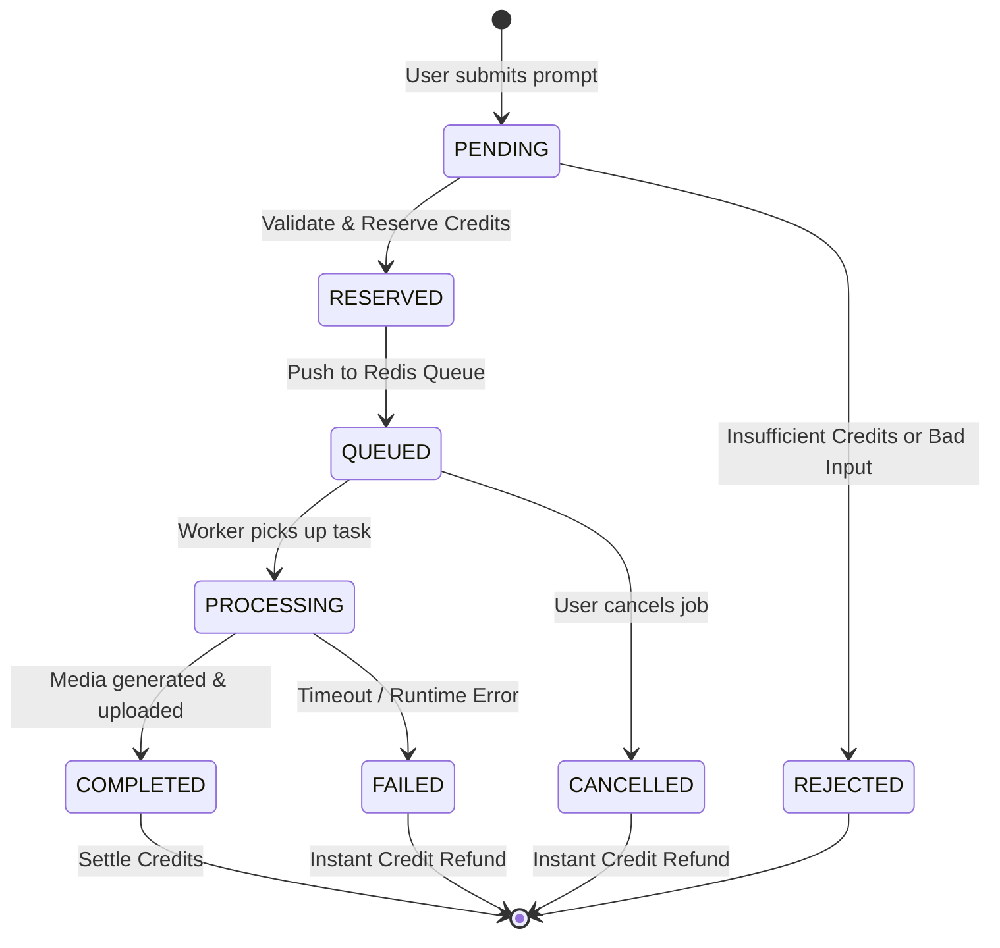

# GENERATION JOB SYSTEM & QUEUE LIFECYCLE

> **Document**: Asynchronous Execution Pipeline  
> **Status**: Approved Foundation  
> **Queue Engine**: Redis + Celery / ARQ

---

## 1. Generation Job Lifecycle State Machine

---

## 2. Step-by-Step Execution Lifecycle

1. **Submission & Request Validation (`POST /api/v1/jobs`)**:
   * Pydantic validates input schemas (aspect ratio, task type, seed).
   * Backend looks up `models_registry` to ensure the requested model is `active` and supports requested parameters.
2. **Credit Estimation & Reservation**:
   * The pricing formula calculates exact credit cost: `RequiredCredits = BaseCost * Multipliers`.
   * A PostgreSQL row-level lock (`SELECT FOR UPDATE`) on `credit_accounts` checks:
     `available = balance - reserved`.
     If `available < RequiredCredits`, reject with `402 Payment Required`.
   * If sufficient, increment `reserved += RequiredCredits`, insert transaction row (`type='RESERVE'`), update job to `RESERVED`.
3. **Queue Enqueue**:
   * Job payload is dispatched into Redis queue:
     * `queue:priority:high` (Subscribers / paid tier)
     * `queue:standard` (Normal generation)
     * `queue:gpu:heavy` (Video / multi-step open-weight models)
4. **Worker Execution**:
   * Worker updates job status to `PROCESSING` with timestamp `started_at`.
   * Emits progress events over Redis Pub/Sub -> FastAPI SSE/WebSocket -> Client UI.
   * If hosted API (Google Vertex AI / Imagen / Veo): makes signed HTTPS request.
   * If GPU worker: loads weights in VRAM, runs inference steps.
5. **Artifact Upload & Output Record**:
   * Generated media (PNG, WebP, MP4, WAV) is written to Object Storage (Google Cloud Storage / Cloudflare R2).
   * Generates low-bandwidth thumbnail.
   * Inserts row into `job_outputs`.
6. **Settlement or Refund**:
   * **Success (`COMPLETED`)**: Decrement `reserved -= RequiredCredits`, decrement `balance -= RequiredCredits`, increment `lifetime_spent += RequiredCredits`. Log `type='SETTLE'`.
   * **Failure (`FAILED`)**: Decrement `reserved -= RequiredCredits` (balance remains untouched). Log `type='REFUND'`. Client notified immediately.
